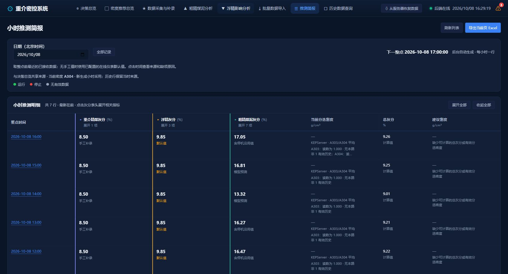

# 决策总览与小时简报共享来源（2026-10-08）

本次把 GPT 决策总览与后续小时简报接入同一个服务器取值及计算入口。当前分选密度默认 A304，可选择 A303 或两路平均。选择写入 SQLite `decision_source_revisions`，每次修改保存版本和生效时间；简报按整点当时已生效版本取数，历史快照不改写。

数值来源包括指定 KEP 点、设备状态组合、手工补录及自动业务取值。手工数据同时受测量时间和入库时间约束。未提供密度或读数为 1 时只沿用对应通道历史，沿用状态不产生调密建议。重介量统一为 501 + 502 − 浮精量 − 粗精煤泥量；新简报统一使用保存的 GPT 模型和 8.5–9.0% 目标范围。

接口为 `GET/PATCH /api/v1/decision/sources`、`GET /api/v1/decision/current`。PATCH 使用已有写鉴权及版本冲突保护；当前计算接口只读。前端首次迁移原本生效的业务点位选择；旧密度本地配置原先不参与 GPT，因此采用原 GPT 实际使用的 A304 默认值。旧生产视图的本地配置保留。

验证结果：

- `pytest backend/tests/test_decision_sources.py backend/tests/test_hourly_brief.py backend/tests/test_decision_live.py -q`：54 passed。覆盖 A303/A304 切换、整点截止、手工补录、GPT 输入及计算一致性、原路密度回退、离线、未来模型/保护参数、409 冲突、非法来源、历史行不变、只读查询及导出。
- `pytest backend/tests/test_training.py -q`：9 passed（DS 原版对拍）。`backend/data/train_js.json` 与 HEAD 的 Git blob 均为 `3308f447d1369fa2efb5e0fe435518c8978f5beb`，未重新生成。
- 6 个 Node VM 脚本通过：`verify_decision_sources`、`verify_decision_realtime`、`verify_decision_overview`、`verify_decision_heavy_amount`、`verify_manual_measurement_points`、`verify_telemetry_retained`。新增共享来源脚本及总览脚本在最后展示修正后复跑。
- 新增 VM 覆盖冷启动迁移、生产偏好保存、PATCH 响应丢失后的回读确认、历史数据徽标、切换来源时丢弃旧在途响应。
- 服务重启后监听 `0.0.0.0:8000`，本机及 Wi-Fi 地址健康检查 200。
- 浏览器实际保存 A304，服务端版本为 2；总览显示 A304 和共享提示，简报显示当前密度 A304、下一整点 17:00。
- 生产库原有 7 行历史快照 SHA-256 均保持不变。部署前已用 SQLite backup API 保存备份，路径见 `before.json`。

现场验证时 A304 原始读数为 1，显示其本路历史有效值约 1.471；入洗量和原煤灰分为 0，使用停机沿用值。501/502 合计不足以抵扣补录组分量，因此当前总灰分和建议密度缺失，并有原因说明。没有为得到完整演示结果修改现场数据。新规则尚未等到真实 17:00 定时生成；整点调度及新行内容已经在隔离数据库集成验证。

