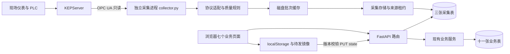

# 系统架构与模块职责

这份说明面向独立维护项目的开发者，描述 2026 年 10 月 5 日改造后的实际代码和下一阶段边界。当前采用模块化单体后端，加一个独立的工业数据采集进程。前端继续使用原生 JavaScript，数据库继续使用 SQLite，便于一人开发、定位问题和部署。

本轮先打通工程基础：采集与网页运行分开、设备数据单独存储、质量和时间明确展示、失败可见、修改有回归检查。现场 KEPServer 尚未联调，实时读数还没有自动进入密度建议计算；当前也没有 PLC 写入功能。

可交互查看：[Archify 系统架构图](archify/architecture-system-20261005-112338/system-architecture.html)。图中包含七个前端板块的职责、后端路由与服务、同一个 SQLite 数据库，以及独立采集进程的只读连接和磁盘缓存；源码依据为提交 `7e54693`。另附[可编辑 JSON](archify/architecture-system-20261005-112338/candidate.json)和[自动校验记录](archify/architecture-system-20261005-112338/system-architecture.finalize-summary.json)。

## 运行架构

网页服务处理查询和用户操作；采集进程连接设备、转换读数并落库。关闭浏览器不会关闭采集进程。两者可以运行在同一台电脑，通过同一个 SQLite 文件交换数据；SQLite 文件必须位于该电脑本地磁盘，不能放到网络共享目录由多台电脑同时写。

## 前端每个板块的职责

| 板块 | 主要文件 | 负责功能 | 数据边界 |
|---|---|---|---|
| 密度推荐总览 | `overview.js` | 系统/皮带筛选、灰分趋势、建议密度、目标参数、模型及存储状态 | 继续使用原有业务取值与决策流程；新增真实后端、采集、同步状态 |
| 数据采集与补录 | `collect.js`、`operations.js` | KEPServer 来源、点位当前值、单位、质量、三种时间；原有业务输入及人工补录 | 新采集面板只读；业务输入保留来源提示，两者尚未自动映射 |
| 粗精煤泥分析 | `coarse.js` | 特征、训练范围、MLR/PLS、拟合图、小时/日视图、DS/GPT 切换 | DS 原版保持；后续算法改动只进入 GPT 专用流程 |
| 浮精影响分析 | `float.js` | 浮精数据与影响关系、筛选、图表 | 使用现有浮精业务记录 |
| 批量数据导入 | `import.js`、`xlsx-lite.js` | Excel 识别、字段映射、数据校验、三类数据导入 | 历史化验/业务数据，不能当成实时设备质量证明 |
| 推测简报 | `brief.js` | 小时对齐、来源解释、预测与建议简报 | 原有取值链；服务端由 `services/brief.py` 支持 |
| 历史数据查询 | `history.js` | 业务记录筛选、浏览、导出及已有管理操作 | 采集历史目前通过 API 查询，尚未整合成该页的新趋势图 |

前端公共代码分工如下。

| 模块 | 职责 |
|---|---|
| `app.js` | 页面协调、业务 store、本地持久化、待发队列、版本冲突处理、现有公式和模型；仍然偏大，是下一阶段拆分对象 |
| `api.js` | HTTP 请求、错误分类、版本头；新增健康和采集查询的超时与返回结构检查 |
| `operations.js` | 每 5 秒查询运行状态，页面隐藏时暂停；显示采集质量、过期和查询中断；不写 store、不训练、不触发密度动作 |
| `chart-lite.js` | Canvas 图表绘制 |
| `style.css`、`index.html` | 页面结构、状态颜色与桌面布局；已检查 1366 宽度，手机适配尚未完成 |

## 后端各层的职责

| 层或模块 | 路径 | 职责 |
|---|---|---|
| HTTP 入口 | `app/main.py` | 装配路由、前端托管、版本信息；暂时保留旧版自动建表和兼容升级 |
| 请求诊断 | `app/observability.py` | 请求编号、方法/路径/状态/耗时日志、统一未知异常响应；不记录请求体、查询参数或认证头 |
| 业务路由 | `app/routers/` | 校验 HTTP 参数、鉴权、调用服务，返回业务结果 |
| 业务服务 | `app/services/` | 密度建议、灰分预测、简报、训练、Excel 导入、快照版本与迁移 |
| 业务持久化 | `app/models.py`、`database.py` | 十一张现有表、连接与事务 |
| 采集配置 | `app/telemetry/config.py` | 来源、点位、量程、周期、安全策略校验；凭据使用环境变量 |
| 协议适配 | `app/telemetry/opcua.py` | asyncua 连接与只读请求，显式获取源时间和服务器时间；证书固定、超时、无自动安全降级 |
| 采集规则 | `app/telemetry/domain.py` | 类型/换算/量程检查、Good/Uncertain/Bad、接收时效和时钟异常判断 |
| 采集存储 | `app/telemetry/repository.py`、`models.py` | 单来源租约、防旧进程覆盖、最新快照、幂等批次、限频历史与清理 |
| 批次缓存 | `app/telemetry/spool.py` | 先原子写文件再入库，提交成功才删除；重启重放未确认批次 |
| 采集循环 | `app/telemetry/worker.py`、`collector.py` | 独立进程、连接/重试/故障状态、有限退避、正常停止和单次读取 |
| 采集 API | `app/routers/telemetry.py` | 最新快照和历史分页，只读，不提供修改点位或写 PLC 的网页入口 |
| 数据库迁移 | `migrations/` | 初始表、训练列、采集表；新增兼容表结构检查和数据保留测试 |

现有路由的业务分工：`records` 管三类测量记录；`samples` 管重介采样；`settings` 管参数；`inputs` 管业务输入；`manual_entries` 管补录；`overview` 管仪表盘计算；`training` 管模型训练；`import_api` 管导入；`assistant` 管解读；`state` 管浏览器整库同步；`migration` 管本地存档迁移；`health` 管运行检查。

## 数据怎样流动

设备读数经过协议适配后，保留原值和换算值，并附带状态码、质量、源时间、服务器时间和本系统接收时间。完成一批读取后先写磁盘缓存，再在短事务中更新最新读数与应保留的历史，提交成功后确认缓存。网页查询这些采集表，不把它们重新写进业务快照。

业务输入仍采用浏览器 localStorage 加后端镜像的过渡模式。修改失败会保留待发快照；配额不足又断网时保留内存副本，并提示本地持久化问题。内存副本在关闭页面后可能丢失，因此不能把它当成磁盘保证。版本冲突需要人工核对；从服务器恢复期间有新修改或在途上传时会取消覆盖。

## 本轮已完成与仍需推进的工作

| 已完成 | 可直接核对的结果 |
|---|---|
| 独立只读采集基础 | 本机模拟 OPC UA 已验证读取、落库、查询；示例配置默认关闭 |
| 质量与时效 | 零值/false 正常保存，坏质量、不确定质量、量程/类型错误、超时明确不可用 |
| 故障恢复基础 | 短暂连接故障有限退避；已落盘批次重放；配置/证书错误显式停采 |
| 可观察性 | 健康检查真实访问数据库；请求编号；网页分别显示后端、采集和同步状态 |
| 数据保护 | 强制业务覆盖前备份失败即停止；采集表独立；新旧同步竞争有回归用例 |
| 自动检查 | CI 安装锁定采集依赖，执行 Python 和前端回归；临时库迁移测试 |

下一阶段按以下顺序做，适合一人维护。

1. **现场只读联调。** 确认服务器地址、端口、安全策略、证书、NodeId、单位、时钟和采样周期，从少量点位开始，比对 KEPServer 客户端显示并记录断线表现。
2. **建立业务输入映射。** 单独定义“哪个点位对应哪个系统/皮带指标”，由服务端统一选择实时值、人工值和历史化验值；坏质量与超时不得静默替换为默认测量值。先影子比较，再切换具体指标。
3. **逐步结束整库镜像。** 按补录、参数、记录拆成增量接口，服务端逐步成为唯一业务事实来源；避免一次同时重写页面和算法。
4. **补齐部署运维。** 进程托管、日志轮转、备份恢复演练、磁盘/采集心跳告警、发布与回滚记录。当前 watchdog 只看进程存活，还不是完整运维监控。
5. **账号权限与操作审计。** 为现场操作员、维护员、管理员明确权限并记录重要修改。现有首页令牌机制不能视为完整的用户身份系统。
6. **继续拆分前端和测试边界。** 先拆 app.js 中同步、持久化和页面协调，再拆 GPT 专用业务模块；保留 DS 算法、共享求解器和基线。

“正规”应落实成可验证的行为、文档和运行流程。当前工程化基础尚不足以宣称满足某个工业控制、信息安全或功能安全标准；正式标准符合性需要明确适用范围和验收证据。

## 本轮验证结果

2026 年 10 月 5 日，在 Python 3.11.9、独立临时 SQLite 和本机模拟 OPC UA 环境完成以下检查。没有连接现场 KEPServer、迁移现场库或更换正在使用的生产服务。

| 检查 | 结果 |
|---|---|
| 全量 `pytest -q` | 223 项通过，保留一条已有 Starlette 测试客户端弃用提示；采集可选依赖已安装，没有相关跳过 |
| DS 原版 `tests/test_training.py` | 9 项通过；原始对拍基线哈希未变 |
| 前端脚本回归 | API 错误、总灰分流程、DS/GPT 切换、可靠性、采集与同步竞争通过 |
| 数据库迁移 | 空库全链路、0002 升级/降级保留业务行、接纳自动建表并保留采集行、不兼容表拒绝升级通过 |
| 真实 Edge 浏览器 | 1366 和 1920 宽度下导航无横向裁切；零值、false、Bad、Uncertain、超时显示通过 |
| 浏览器断网恢复 | 离线显示“后端离线”和 0/6 有效点位；恢复后回到在线和 3/6，演示数据明确标注 |
| 依赖与配置 | `pip check`、配置校验、示例 JSON、CI YAML 解析、Git 差异检查通过 |

CI 配置已更新，远端 GitHub 作业尚未触发。浏览器的检查截图位于本地 `output/playwright/`，没有加入版本库。工程化改动保存在 `engineering/telemetry-foundation-20261005` 分支；DS 训练、预测、聚合、参数选择及页面分支没有修改。
